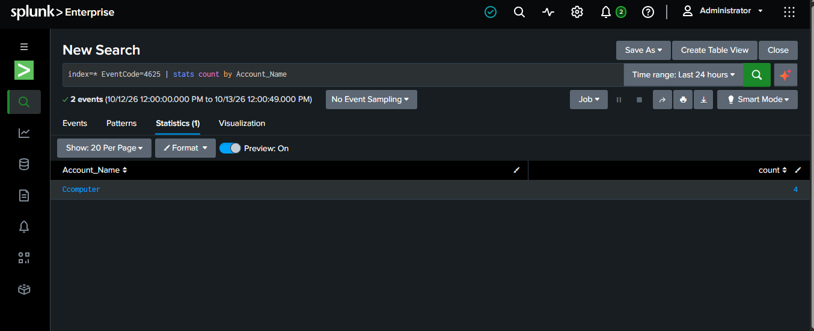

# Windows Failed Login Analysis Using Splunk

## Project Overview
This is a beginner-level SOC Analyst project focused on analyzing Windows Security Logs using Splunk.

## Objective
To identify and review failed login events and understand the information recorded by Windows.

## Tools Used
- Splunk
- Windows Event Viewer
- Windows Security Logs

## Event Investigated
- **Event ID 4625:** Failed logon
- **Account Name:** Sanitized example
- **Failure Reason:** Unknown user name or bad password
- **Logon Type 2:** Local interactive logon

## Splunk Queries

### 1. Search for failed login events
```spl
index=* EventCode=4625
```

### 2. Count events by account
```spl
index=* EventCode=4625
| stats count by Account_Name
```

### 3. Review event details
```spl
index=* EventCode=4625
| table _time Account_Name Failure_Reason
```
## Screenshot



## Findings
Failed login events were found in the available Windows Security Logs. The recorded failure reason was "Unknown user name or bad password."

A failed login alone does not confirm a cyberattack. Further investigation would be needed to determine whether the activity was suspicious.

## Learning Outcomes
- Searching Windows events in Splunk
- Understanding Event ID 4625
- Using basic SPL commands such as `stats` and `table`
- Reviewing failed login activity

## Disclaimer
This project is for beginner learning and educational purposes. Account details should be sanitized before publishing.
